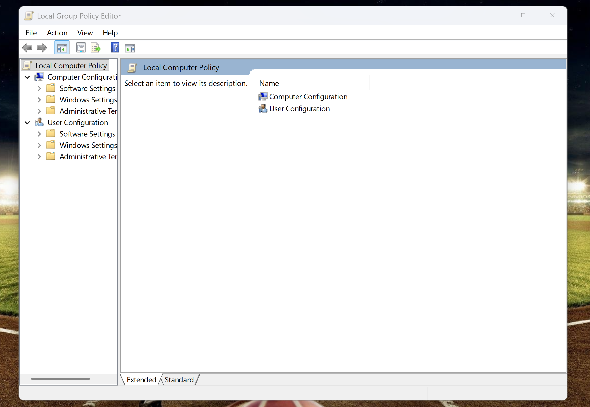
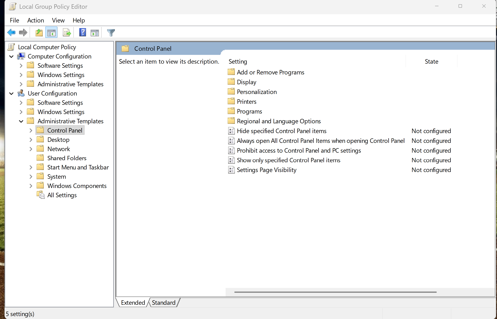
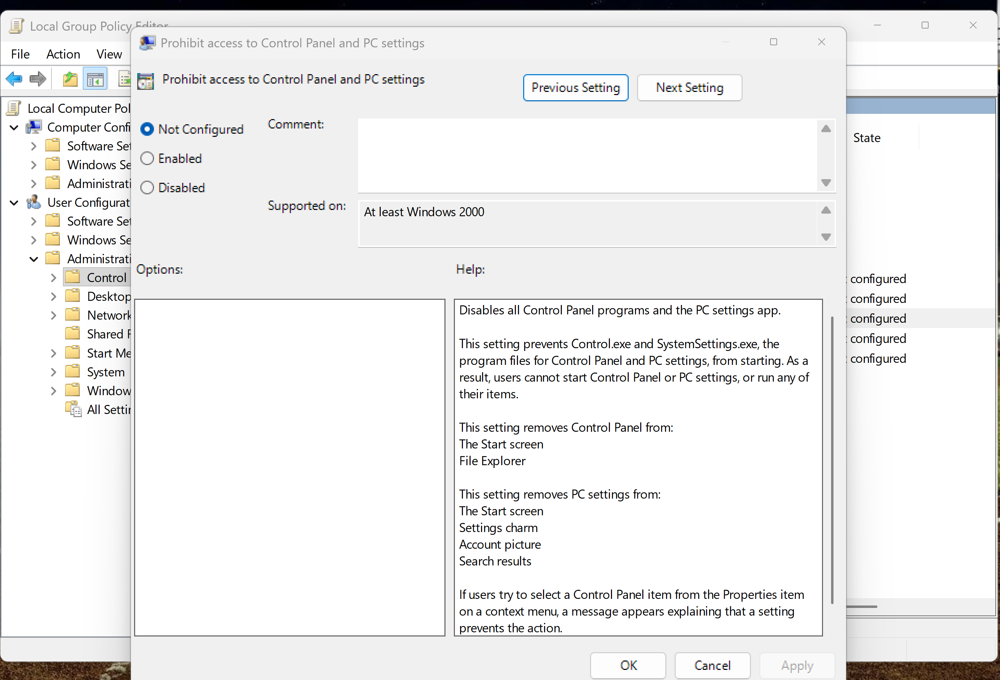
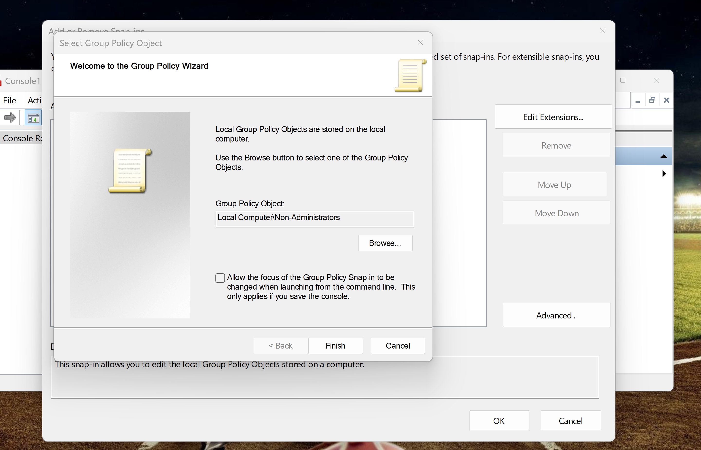
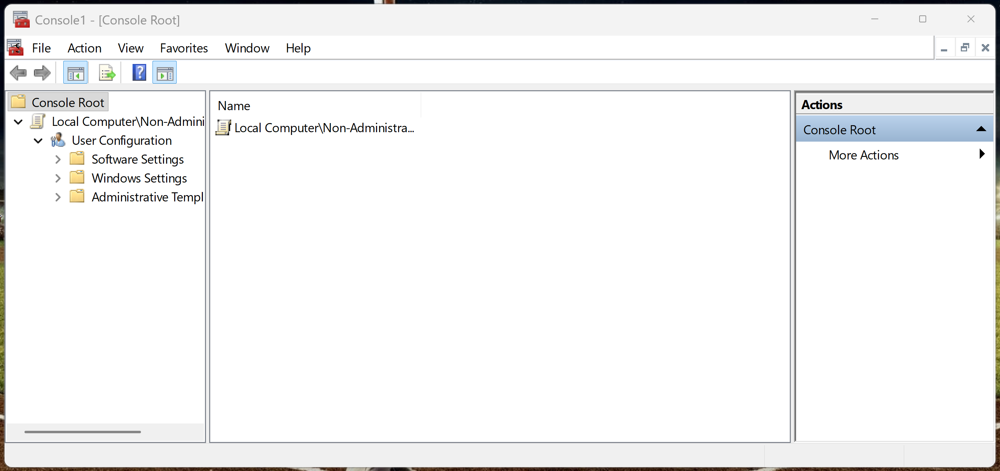
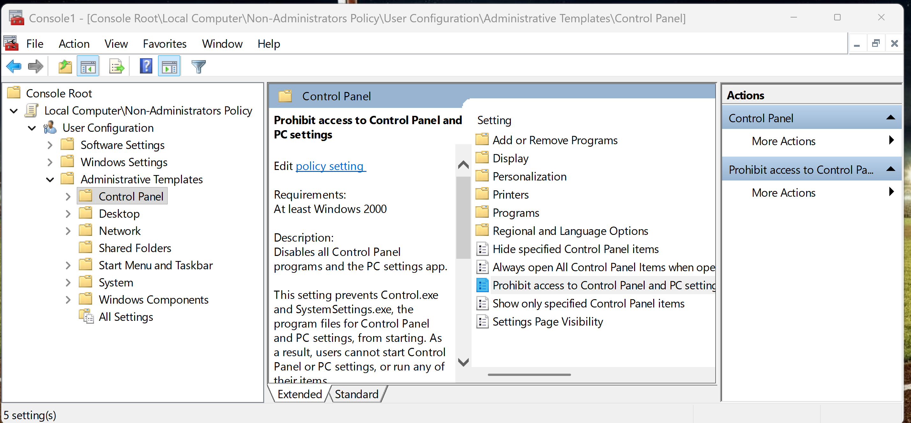
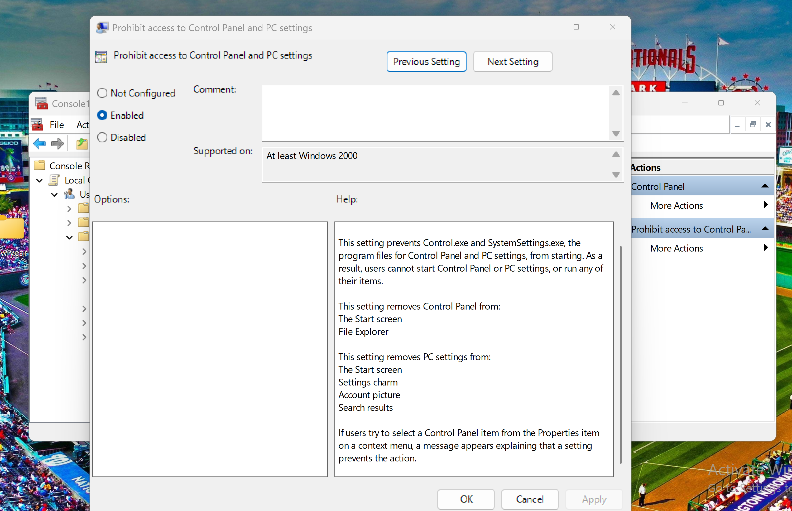
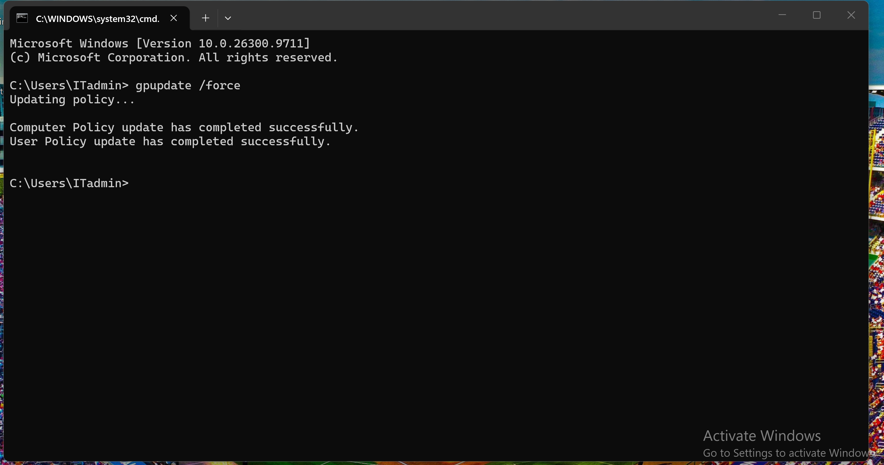

# TechNova IT Support — Ticket #1050

## Windows 11 Local Group Policy Administration

**Ticket Status:** Resolved  
**Priority:** Medium  
**Category:** Windows Security / Local Group Policy  
**Environment:** Windows 11 Pro — PC01  
**Lab Type:** Simulated IT Administration Task

---

## 1. Business Scenario

The TechNova IT department received a request to prevent standard employees from accessing Windows Control Panel and Settings to reduce unauthorized system configuration changes.

The IT Support Technician was assigned to configure a local Group Policy restriction, verify that it affected non-administrator accounts without restricting administrators, and safely reverse the configuration after testing.

## 2. Lab Objectives

- Configure Local Group Policy using Microsoft Management Console (MMC).
- Apply a restriction specifically to non-administrator users.
- Block access to Control Panel and Windows Settings.
- Refresh Group Policy using `gpupdate /force`.
- Verify policy application using `gpresult`.
- Confirm that administrative access remains unaffected.
- Reverse the policy and verify restored access.

## 3. Lab Environment

| Component | Configuration |
|---|---|
| Workstation | PC01 |
| Operating System | Windows 11 Pro |
| Virtualization | VMware Workstation |
| Administrator Account | ITadmin |
| Standard User Account | Brian Martinez |
| Policy Target | Local Computer\Non-Administrators |
| Management Tools | MMC, Local Group Policy Editor, Command Prompt |

## 4. Configuration and Troubleshooting

### Step 1 — Open Local Group Policy Editor

Opened the Local Group Policy Editor using:

```cmd
gpedit.msc
```

Navigated to:

`User Configuration → Administrative Templates → Control Panel`

Identified the policy **Prohibit access to Control Panel and PC settings**.

### Step 2 — Configure Non-Administrator Policy

Opened Microsoft Management Console:

```cmd
mmc
```

Added the **Group Policy Object Editor** snap-in and selected:

`Browse → Users → Non-Administrators`

This configuration targeted standard users while preserving administrator access.

### Step 3 — Enable the Security Restriction

Within the Non-Administrators Policy, navigated to:

`User Configuration → Administrative Templates → Control Panel`

Configured **Prohibit access to Control Panel and PC settings** to **Enabled**.

### Step 4 — Update Group Policy

Executed:

```cmd
gpupdate /force
```

The policy update completed successfully.

### Step 5 — Test the Restriction

Signed in using the standard user account Brian Martinez.

Attempted to open Windows Settings and Control Panel.

Windows blocked access to Control Panel and displayed a restriction message indicating that the operation was prohibited by the computer's administrative policies.

### Step 6 — Verify Applied Group Policy

Executed:

```cmd
gpresult /r /scope user
```

Confirmed that the following policy appeared under Applied Group Policy Objects:

`Local Group Policy\Non-Administrators`

### Step 7 — Verify Administrator Access

Signed in using the ITadmin account.

Confirmed that Control Panel and Windows Settings remained accessible.

### Step 8 — Reverse the Policy

Returned to the Non-Administrators Group Policy configuration and changed the restriction from **Enabled** to **Not Configured**.

Refreshed Group Policy and signed in again as Brian Martinez.

Confirmed that Control Panel and Windows Settings were accessible after the policy rollback.

## 5. Results

- Successfully configured a targeted local Group Policy.
- Restricted Control Panel and Settings for a standard user.
- Verified policy application using `gpresult`.
- Preserved administrator access.
- Successfully reversed the configuration.
- Confirmed that the standard user regained access.

**Final Ticket Status: RESOLVED**

## 6. Skills Demonstrated

- Windows 11 Administration
- Local Group Policy Management
- Microsoft Management Console (MMC)
- User-Based Security Restrictions
- Administrative Templates
- Group Policy Troubleshooting
- Command-Line Diagnostics
- Security Policy Rollback
- IT Support Documentation

## 7. Security Best Practices

Group Policy restrictions should be tested with standard user accounts before broad deployment.

Administrative access should be preserved to prevent accidental lockouts.

Policy changes should be documented, verified, and reversible.

## 8. Evidence


## 8. Evidence — Screenshots

### 01 — Local Group Policy Editor
Opened the Local Group Policy Editor (`gpedit.msc`) on PC01 to review Computer Configuration and User Configuration.



### 02 — Identifying the Control Panel Restriction
Navigated to User Configuration > Administrative Templates > Control Panel and located the restriction policy, initially Not Configured.



### 03 — Reviewing Initial Policy Settings
Opened the restriction policy to review its configuration options. The initial setting was Not Configured.



### 04 — Selecting the Non-Administrators GPO
Used Microsoft Management Console (MMC) to select Local Computer\Non-Administrators as the Group Policy Object.



### 05 — Non-Administrators Policy Editor
Verified the Non-Administrators Group Policy Object in MMC and expanded User Configuration.



### 06 — Locating the Restriction in MMC
Located the Control Panel restriction under User Configuration > Administrative Templates > Control Panel within the Non-Administrators GPO.



### 07 — Enabling the Control Panel Restriction
Configured Prohibit access to Control Panel and PC settings to Enabled for the Non-Administrators policy.



### 08 — Refreshing Group Policy
Executed `gpupdate /force`. Windows confirmed successful Computer Policy and User Policy updates.



### 09 — Verifying Access Restriction
Tested Control Panel access after applying the policy. Windows displayed a restriction message, demonstrating that the operation was blocked.


  
---

**Project:** TechNova IT Support Lab  
**Ticket:** #1050 — Local Group Policy Administration  
**Status:** Resolved
